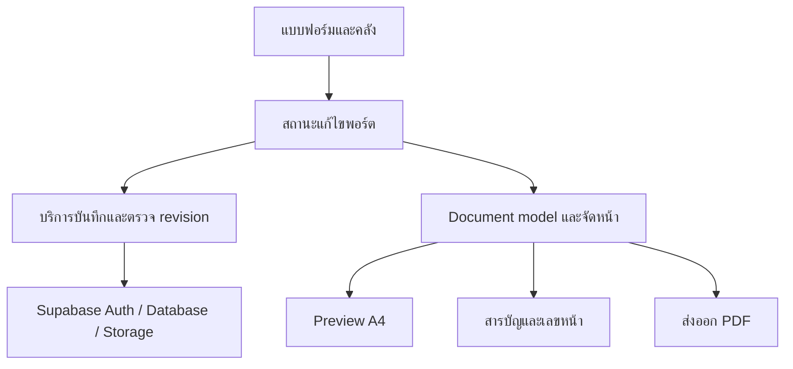

# สถาปัตยกรรมระบบ — เว็บแอปพลิเคชันจัดทำแฟ้มสะสมผลงาน

ฉบับ 1.1 ข้อกำหนดที่ยืนยันล่าสุด • 15 ตุลาคม 2569 (2026-10-15)

## 1. วิธีอ่านเอกสาร

ส่วน “ปัจจุบัน” คือสิ่งที่อ่านพบใน repository ที่ commit `60f4d5686d6df01d5b8500aeaa0608938bda09ca` ของ branch `codex/portfolio-system-fixes` ไม่ใช่ผลทดสอบระบบที่ deploy อยู่ ส่วน “เป้าหมาย” อ้าง `PRD.md` ส่วน “ข้อเสนอทางเทคนิค” คือแนวทางให้ผู้พัฒนาตรวจและออกแบบรายละเอียดก่อนลงมือ

Repository: https://github.com/zenecoil0-design/projectfinal

ภาพ schema ที่แนบมีบางส่วนถูกตัด และไม่ครอบคลุมตารางคลังที่โค้ดปัจจุบันใช้ จึงใช้ประกอบความเข้าใจเท่านั้น ยังไม่ได้อ่าน schema, RLS, Storage policies และการตั้งค่า Auth ของ Supabase จริง ห้ามใช้ภาพนี้เป็นฐานสร้าง migration โดยไม่ตรวจเพิ่มเติม

## 2. เทคโนโลยีที่พบใน package.json

| ส่วน | เทคโนโลยี/เวอร์ชันที่ประกาศ |
| --- | --- |
| Framework | Next.js `16.2.9` ใช้ App Router |
| UI | React / React DOM `19.2.4`, TypeScript `^5` |
| Style | Tailwind CSS `^4`, Noto Sans Thai `^5.3.0`, React Icons |
| State | Zustand `^5.0.14` |
| Backend | Supabase JS `^2.116.0`, Supabase SSR `^0.12.7` |
| PDF | `html-to-image ^1.11.13` และ `jspdf ^4.2.1` |
| Tests | Node test runner ผ่าน `tsx`, Playwright, PGlite |

ค่าที่มี `^` เป็นช่วง dependency ที่ประกาศ ต้องตรวจ `package-lock.json` เมื่อจำเป็นต้องระบุเวอร์ชันติดตั้งจริง โครงงานเดิมกล่าวถึงไลบรารีบางตัวต่างจากปัจจุบัน ให้ยึด dependency และโค้ดจริง

## 3. โครงสร้างปัจจุบัน

| ตำแหน่ง | หน้าที่ |
| --- | --- |
| `src/app/page.tsx`, `dashboard/page.tsx` | หน้าเข้าใช้งานและพอร์ต |
| `src/app/login`, `register` | หน้าบัญชีผู้ใช้ |
| `src/app/my-data/page.tsx` | หน้าคลังข้อมูลส่วนตัว |
| `src/app/editor/page.tsx` | โหลดพอร์ตตาม query `portfolio`, ประกอบแบบฟอร์ม/Preview/เทมเพลต/ส่งออก |
| `src/components/forms` | แบบฟอร์มปก คำนำ ประวัติส่วนตัว และตัวเลือกรายการจากคลัง |
| `src/components/my-data` | เพิ่ม/แก้/ลบข้อมูลคลังทั้ง 3 หมวด |
| `src/components/layout` | `SidebarMenu` เมนูแยกด้านบน และ `FormContainer` ด้านล่าง |
| `src/components/editor` | สถานะ session, การเลือกเทมเพลต และปุ่มส่งออก |
| `src/components/preview` | ตัวแสดงแต่ละหมวด, `Paper`, `PaginatedSection` |
| `src/components/images/CropInput.tsx` | เลือกและครอปรูป ปรับซูมและตำแหน่ง |
| `src/store` | สถานะแก้ไขแต่ละส่วนด้วย Zustand |
| `src/lib/editor` | snapshot สำหรับตรวจ dirty, การเลือกข้อมูล, จัดหน้าและส่งออก |
| `src/lib/supabase`, `src/middleware.ts` | client/server Supabase และ session/access routing |
| `supabase/migrations` | migration RPC การบันทึกชุดรายการที่เลือกแบบ transaction |
| `tests` | unit/database-oriented tests และ E2E พร้อม mock Supabase |

คำว่า snapshot ใน session ปัจจุบันใช้ตรวจว่ามีการแก้ค้าง ไม่ได้แปลว่าระบบมี snapshot เนื้อหาจากคลังแบบ B แล้ว

## 4. การไหลข้อมูลปัจจุบันที่ตรวจพบ

1. Editor รับ `portfolio` ID ตรวจผู้ใช้ และโหลด `portfolios` โดยกรองเจ้าของ
2. `covers`, `prefaces`, `profiles` โหลดเข้าสู่ store ของแต่ละส่วน
3. แบบฟอร์มการศึกษา/กิจกรรม/เกียรติบัตรโหลดรายการจากคลังและความสัมพันธ์ที่เลือกในพอร์ต
4. นำข้อมูลล่าสุดของรายการในคลังมาสร้างข้อมูลสำหรับ Preview; กิจกรรม/เกียรติบัตรนำรูปทั้งหมดของรายการมาใช้
5. บันทึกชุด ID ที่เลือกผ่าน `replace_portfolio_selection` พร้อมลำดับ
6. Preview แสดง A4 ขนาด layout 794 × 1123 px และใช้ scale ย่อทั้งหน้าเพื่อพอดี viewport
7. ส่งออก clone หน้า DOM ที่ไม่ถูก scale แล้วแปลงผ่าน canvas เป็นภาพ JPEG บน PDF A4

### ตารางที่โค้ดอ้างถึง

| กลุ่ม | ตาราง |
| --- | --- |
| พอร์ต | `portfolios`, `covers`, `prefaces`, `profiles` |
| คลัง | `user_library_educations`, `user_library_activities`, `user_library_certificates` |
| รูปคลัง | `user_library_activity_images`, `user_library_certificate_images` |
| รายการในพอร์ต | `portfolio_educations`, `portfolio_activities`, `portfolio_certificates` |
| Tags | `user_tags`, `user_library_activity_tags`, `user_library_certificate_tags` |

ชื่อเหล่านี้ยืนยันจากโค้ดที่อ่าน ไม่ใช่การยืนยันว่าตาราง นโยบาย หรือ migration ถูกติดตั้งในฐานข้อมูลที่ใช้งานจริงแล้ว

RPC ปัจจุบันตรวจ `auth.uid()`, เจ้าของพอร์ต, เจ้าของรายการ, ID ซ้ำ/ว่าง และใช้ transaction เพื่อให้ความล้มเหลวระหว่างบันทึกไม่ล้างชุดเดิม ต้องรักษาคุณสมบัตินี้เมื่อเพิ่ม snapshot และตัวเลือกรูป

## 5. ช่องว่างจากข้อกำหนดใหม่

| เรื่อง | สิ่งที่ตรวจพบ | งานเป้าหมาย |
| --- | --- | --- |
| เมนูฝั่งซ้าย | 6 ปุ่มเหนือแบบฟอร์ม | หมวดพับ–ขยายรวมแบบฟอร์ม พร้อมสารบัญและขั้นตอนสี/ดาวน์โหลด |
| มือถือ | มีสลับกรอก/Preview และเลื่อนไปหมวด | ใช้ต่อ เพิ่มซูมและตรวจหมวดซ่อน/ว่าง |
| A4 | ขนาดคงที่และย่อทั้งหน้าแล้ว | รักษาหลักนี้ทุกเทมเพลตและตัวส่งออก |
| เกียรติบัตร | คลังจำกัด 4 รูป | เปลี่ยนเป็น 2 รูป พร้อมแผนข้อมูลเก่า |
| ช่องกิจกรรม/เกียรติบัตร | มีชื่อ รายละเอียด วันที่ หน่วยงาน Tags | ชื่อ/รายละเอียด/รูป และ Tags ส่วนตัว; ช่องอื่นไม่แสดงแยก แต่รักษาข้อมูลเดิม |
| เลือกรูป | เก็บรายการที่เลือกและนำรูปทั้งหมดมาใช้ | เก็บชุดรูปที่เลือกแยกในแต่ละพอร์ต |
| แบบ B | โหลดเนื้อหาจากคลังเมื่อเปิดพอร์ต | เก็บ snapshot พร้อมต้นทางและ version และแจ้งรับข้อมูลใหม่ |
| บันทึกพอร์ต | ปุ่มบันทึก, dirty state, เตือนก่อนออก | autosave ที่ป้องกัน race/ข้อมูลหาย |
| สารบัญและเลขรวม | Editor ที่อ่านยังประกอบ 6 หมวด ไม่มีสารบัญ | page model กลางและสารบัญ/เลขหน้ารวม |
| แบ่งหน้า | pack การ์ดทั้งใบ; การ์ดใหญ่เกินหน้าไม่แบ่ง | split รายการใหญ่พร้อม “(ต่อ)” |
| จำนวนหน้า | ฐานเดิมมี MAX_PAGES=10; รอบ 16 ต.ค. 2026 ถอดเพดาน UI/export แล้ว ดู [ผลตรวจ PDF](docs/verification/PDF_PAGE_LIMIT_REVIEW.md) | ไม่มีเพดานเชิงผลิตภัณฑ์; ยังต้องประเมินทรัพยากรอุปกรณ์จริง |
| ขนาด PDF | `MAX_PDF_BYTES = 10_000_000` พร้อมลดคุณภาพภาพ และหยุดเมื่อยังเกิน | พยายามต่ำกว่า 10 MB รักษาคุณภาพ หากยังไม่ต่ำกว่าเป้าหมายให้ยืนยันดาวน์โหลดต่อได้ |
| สี | เทมเพลต `modern` ใช้สีคงที่ใน CSS | สีหลัก/รองรายพอร์ตและ token ของเทมเพลต |
| บัญชี | signUp รองรับกรณีไม่มี session/ต้องยืนยัน | ตรวจการตั้งค่า Auth จริง; เพิ่ม flow ลืมรหัสผ่านที่ครบ |

มีตัวเลือก `classic`, `modern` (Emerald Editorial), `minimal` ใน UI ที่ตรวจ โดย `minimal` ระบุว่าเป็นรูปแบบพื้นฐาน ไม่ใช่หลักฐานว่าทุกตัวเลือกสมบูรณ์แล้ว เป้าหมายที่ยืนยันคือ 3 แบบสมบูรณ์: เรียบทางการ ทันสมัย และมินิมอล เสนอใช้ key เดิมต่อโดยตรวจ mapping และข้อมูลที่มีอยู่ก่อน

## 6. ข้อเสนอทางเทคนิค: การแบ่งความรับผิดชอบเป้าหมาย

รักษา Next.js + Supabase + Zustand เดิมก่อน ไม่ย้าย stack โดยไม่มีเหตุผล

- **UI แบบฟอร์ม:** รับ input, validation, แสดงสถานะและเรียกงานบันทึก ไม่รวมตรรกะการจัดหน้าไว้ในช่องกรอก
- **ข้อมูลพอร์ต:** เก็บชื่อ template สี visibility snapshot รายการและการเลือกรูป เป็นข้อมูลพอร์ตที่บันทึกถาวร
- **สถานะ UI ชั่วคราว:** หมวดที่เปิด, แท็บมือถือ, zoom, progress ไม่ใช้แทนข้อมูลถาวร
- **คลัง:** เป็นข้อมูลต้นทาง version ใหม่ การแก้ไม่เขียนทับ snapshot พอร์ตโดยตรง
- **ชั้นบันทึก:** จัดการ ownership, transaction, revision และข้อผิดพลาดที่กู้คืนได้
- **Document model:** เปลี่ยนข้อมูลพอร์ตเป็นบล็อกและหน้า ใช้ร่วมกันระหว่าง Preview สารบัญและ PDF
- **Renderer:** ใช้เทมเพลตและสีที่เลือก วัดขนาดในพื้นที่ A4 จริง ไม่วัดจาก viewport มือถือ

## 7. ข้อเสนอทางเทคนิค: snapshot และรูป

ไม่บังคับชื่อตารางใหม่ก่อนอ่าน schema เต็ม สามารถต่อยอดตารางความสัมพันธ์เดิม โดยต้องมีแนวคิดข้อมูลต่อไปนี้:

| ข้อมูล | หน้าที่ |
| --- | --- |
| `portfolio_id` และเจ้าของ | ผูกกับพอร์ตที่ได้รับสิทธิ์ |
| `source_item_id` และชนิดหมวด | คงที่มาจากคลังสำหรับตรวจ update/delete |
| `source_version` | version ของรายการเมื่อเลือกรับมา |
| `snapshot_payload` | ข้อความ/ข้อมูลการศึกษาที่ใช้จริงในฉบับนี้ |
| `selected_images` | asset ID/version ของรูปที่เลือก ไม่ใช้ index ของ array เป็นอัตลักษณ์ |
| `sort_order` | ลำดับที่ผู้ใช้ติ๊กเลือก |
| `revision` | ป้องกันการเขียนทับจาก autosave หรืออีกแท็บโดยไม่รู้ตัว |

ใช้ asset หรือ object key ที่ไม่ถูกเขียนทับเมื่อเปลี่ยนภาพ เพื่อให้ snapshot เก่ายังเปิดรูปเดิมได้ จัดการวงจรไฟล์ตามการอ้างอิง ไม่ใช้ URL ชั่วคราวเป็นแหล่งถาวร

### รับการอัปเดต

1. โหลด snapshot ของพอร์ต พร้อมตรวจ version ของต้นทาง
2. ถ้าต้นทางเปลี่ยน แสดงสรุปความต่างและปุ่มรับใหม่/ใช้เดิม
3. เมื่อรับใหม่ ทำรายการบันทึกที่รักษาลำดับและเก็บชุดรูปที่ยังคงมีอัตลักษณ์เดิม
4. ถ้ารูปที่เลือกถูกเปลี่ยน/ลบจากต้นทาง ให้ผู้ใช้เห็นและเลือกยืนยันชุดใหม่ ไม่แทนด้วยรูปคนละรูปเงียบ ๆ
5. การอัปเดตพอร์ตหนึ่งฉบับไม่กระทบพอร์ตอื่น

รายละเอียดการเลือกรูปเมื่อรับ update เป็นข้อเสนอให้ตรวจ UX ระหว่าง implementation ต้องรักษาหลัก “ผู้ใช้รู้ผลและยืนยัน” ของ PRD

### ลบทั้งรายการจากคลัง

- ตรวจรายการพอร์ตที่อ้างถึงทั้งหมดของเจ้าของบัญชี รวมสำเนาและหมวดที่ปิดอยู่
- ส่งชื่อและจำนวนพอร์ตให้แสดงในกล่องยืนยัน
- ตรวจผลกระทบอีกครั้งก่อน commit หากมีพอร์ตเพิ่มเข้ามาระหว่างนั้นให้แจ้งข้อมูลที่เปลี่ยน
- ลบคลังและ snapshot/ความสัมพันธ์ที่เกี่ยวข้องในทุกพอร์ตอย่างเป็น transaction หรือกลไกที่ให้ผลสอดคล้องกัน
- เพิ่ม revision ให้พอร์ตที่ได้รับผล ป้องกัน autosave เก่าเขียนรายการที่ลบกลับคืน
- การลบไฟล์ Storage อยู่นอก database transaction ให้แยก cleanup ที่ retry ได้ และตรวจ reference ของ asset ก่อนลบ
- ถ้าลบเพียงพอร์ต ให้ลบข้อมูลของฉบับนั้น แต่ห้ามลบคลัง/asset ที่ยังอ้างถึงจากคลังหรือพอร์ตอื่น

## 8. ข้อเสนอทางเทคนิค: autosave

- หลังโหลดข้อมูลครบจึงเริ่มติดตามการแก้ ห้ามบันทึกค่าเริ่มต้นทับข้อมูลระหว่างโหลด
- debounce การพิมพ์และ serialize งานเขียนของพอร์ตเดียวกัน; revision ที่เก่ากว่าต้องไม่ทับค่าล่าสุด
- ข้อมูลฉบับร่างยอมให้ไม่ครบ; validation สำหรับคลังและการส่งออกแยกจากการรักษาฉบับร่าง
- บันทึกข้อมูลรูปหลังอัปโหลดสำเร็จ ไม่เก็บ `blob:` URL เป็นข้อมูลถาวร
- ปุ่มดาวน์โหลดต้องรอการบันทึกฉบับที่จะส่งออก และใช้ snapshot เดียวกันตลอดงาน export
- เน็ตล้มเหลว: เก็บค่าใน editor แสดง error และ retry ไม่อ้างว่าบันทึกถาวรแล้ว
- เมื่อเปิดจากอุปกรณ์อื่นหลัง save สำเร็จต้องได้ข้อมูลล่าสุด กรณีหลายอุปกรณ์แก้พร้อมกันให้ตรวจ conflict แทนการเขียนทับเงียบ ๆ
- reset store และยกเลิกงาน async เมื่อเปลี่ยนพอร์ต เปลี่ยนบัญชี หรือออกจากระบบ

## 9. ข้อเสนอทางเทคนิค: layout และ PDF

- เก็บ layout A4 ที่ขนาดอ้างอิงเดียว เช่น 794 × 1123 CSS px ตามของเดิม แล้ว scale เฉพาะ viewport
- วัดเนื้อหาหลังฟอนต์และรูปพร้อม รวมพื้นที่หัวหมวด เลขหน้า ส่วนท้าย และ gap จริงของเทมเพลต
- สร้างบล็อกข้อความและรูป; ย้ายรายการทั้งใบก่อน แล้ว split รายการที่ใหญ่เกินหน้าเต็มโดยรักษาลำดับและต่อเนื่อง
- สารบัญและเลขหน้ามาจาก page map เดียวกัน หากสารบัญหลายหน้าต้องคำนวณจนการแบ่งหน้าคงที่
- มีทั้ง physical page index สำหรับจำนวนหน้ารวม และ printed page number เริ่ม 1 ที่เนื้อหา
- หมวดที่ปิดหรือว่างไม่สร้างหน้าข้อความ placeholder ใน PDF
- ส่งออกทีละหน้าเพื่อลดภาระหน่วยความจำ แสดง progress; ไม่ใส่เพดาน 10 หน้าเชิงธุรกิจกลับมา
- การสร้าง PDF ปัจจุบันเป็นภาพ raster ไม่ใช่ข้อความที่เลือก/ค้นหาได้ ห้ามรับรองความสามารถค้นหาข้อความจนกว่าจะเปลี่ยน renderer และทดสอบ
- ตรวจว่ารูปเกียรติบัตรอ่านได้หลังบีบอัด และไม่ stretch รูปหรือหน้ากระดาษ
- เปลี่ยนผลลัพธ์ตัวสร้าง PDF ให้คืน blob, ขนาดจริง และสถานะไม่ต่ำกว่าเป้าหมาย แทนการ throw error อย่างเดียวเมื่อไฟล์เกิน 10 MB
- ลดคุณภาพได้เฉพาะถึงค่าขั้นต่ำที่ผ่านการตรวจภาพจริง หากยังไม่ต่ำกว่า 10,000,000 bytes ให้ UI ขอคำยืนยันก่อนดาวน์โหลด เก็บ blob เดิมที่แจ้งขนาดไว้เพื่อให้ไฟล์ดาวน์โหลดตรงกับที่ยืนยัน
- ข้อเสนอข้อมูลอายุ: `age_mode` เป็น `auto` หรือ `manual`, `manual_age` เป็นจำนวนเต็มไม่ติดลบ, วันเกิดคงแยกไว้; การเปลี่ยนวันเกิดไม่ทับค่า manual และโหมด auto ใช้วันอ้างอิงเดียวกันทั้งการจัดหน้าและ export ครั้งนั้น

## 10. สิทธิ์และการตั้งค่า

- ตรวจ ownership และ RLS ของพอร์ต คลัง รูปและ Tags ทุกชั้น การกรอง `user_id` ใน frontend อย่างเดียวไม่ใช่หลักประกัน
- ตรวจ Storage policies ด้วย โค้ดเดิมใช้ `portfolio-images` และ public URL ยังไม่ยืนยันว่าการเข้าถึงรูปเป็นส่วนตัวตามความต้องการคลังส่วนตัว
- ตรวจความเหมาะสมของ private bucket/signed URL หรือการส่งผ่าน backend โดยต้องใช้ export ได้ และไม่เปลี่ยน policy จนตรวจผลกระทบข้อมูลเดิม
- ใช้เฉพาะ public anon key ฝั่ง client ห้ามนำ service role key ไปใน bundle หรือเอกสาร
- environment ที่โค้ดใช้: `NEXT_PUBLIC_SUPABASE_URL`, `NEXT_PUBLIC_SUPABASE_ANON_KEY` ไม่ใส่ค่าจริงในไฟล์นี้
- ช่วงนี้ไม่บังคับยืนยันอีเมลตามคำขอ แต่ห้ามเดาว่าค่าบน Supabase ตั้งไว้แล้ว
- เพิ่ม flow ลืมรหัสผ่าน/หน้า reset/callback และตรวจ redirect ที่อนุญาต; ไม่ทำระบบเก็บรหัสผ่านเอง

## 11. ลำดับการพัฒนาที่เสนอ

1. ตรวจ schema/RLS/Storage และข้อมูลเก่า สร้าง migration ที่รักษาข้อมูลสำหรับ snapshot รูปที่เลือก สี visibility และ revision
2. ปรับคลังให้ตรงชื่อ/รายละเอียด/รูป 4 และ 2 พร้อม Tags ส่วนตัว และขั้นตอนลบที่แสดงผลกระทบ
3. เพิ่ม snapshot รับการอัปเดต การเลือกรูป และ autosave ที่ป้องกัน conflict
4. เปลี่ยน Editor เป็น Accordion ใช้ mobile switch และ preview scale เดิมต่อ
5. ทำ page model, สารบัญ, เลขหน้า, split รายการ และยกเลิกเพดาน 10 หน้า
6. เพิ่มสี ทำสำเนา แก้ metadata และ flow ลืมรหัสผ่าน
7. ทดสอบรวมตามเกณฑ์ PRD หลังทุกส่วนเสร็จ และส่งหลักฐาน/ข้อจำกัดจริง

ลำดับนี้เป็นข้อเสนอทางเทคนิค ไม่ใช่คำสั่งให้เริ่มแก้โค้ดทันทีหลังอ่านเอกสาร

## 12. การตรวจสอบและสิ่งที่ยังไม่ยืนยัน

- การจัดทำเอกสารรอบนี้อ่านโค้ดเท่านั้น ไม่ได้รัน `npm test`, lint, build หรือ E2E
- ไม่มีหลักฐานยืนยัน schema จริง RLS Storage policies การ deploy migration และการตั้งค่าอีเมลใน Supabase
- ข้อกำหนดหลักยืนยันครบ: PDF ตั้งเป้า 10 MB พร้อมยืนยันเมื่อไฟล์ใหญ่, อายุ auto/manual, เทมเพลต 3 แบบ และปรับข้อมูลทดลองเข้าระบบใหม่ได้
- ก่อนแก้ฐานข้อมูลให้ตรวจขอบเขตข้อมูลทดลองและรายการที่เกินข้อจำกัดจริง การปรับเข้าข้อกำหนดใหม่ไม่เท่ากับการอนุญาตล้างฐานข้อมูล การเก็บ/ลบไฟล์ที่ได้รับผลกระทบต้องมีแผนเป็นรูปธรรม
- ต้องทดสอบบนมือถือจริงก่อนอ้างว่าการครอป ซูม และดาวน์โหลดทำงานครบ
