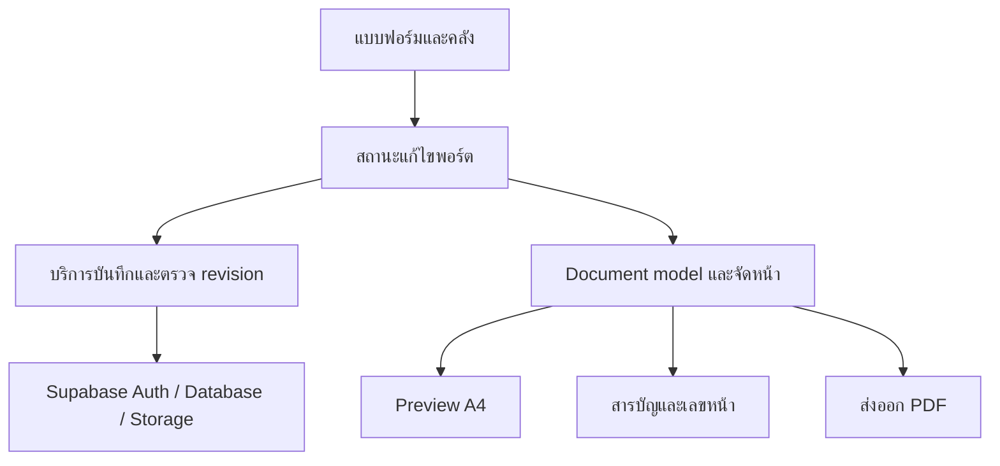

# สถาปัตยกรรมระบบ — เว็บแอปพลิเคชันจัดทำแฟ้มสะสมผลงาน

ฉบับ 1.2 • ปรับขอบเขตรอบส่ง 23 ตุลาคม 2569 (2026-10-23, Asia/Bangkok)

**คำยืนยันล่าสุดของเจ้าของ:** รอบส่งใช้ manual save + dirty warning, เลือกรายการ/ลำดับแยกรายพอร์ตและใช้รูปทั้งหมดตามลำดับคลัง, โหลดข้อมูลคลังร่วมใหม่เมื่อเปิดอีกครั้งโดยไม่ทับ draft ที่กำลังแก้ ไม่มี realtime ส่วน Autosave เนื้อหา/รูปย่อยรายพอร์ต/snapshot-version-รับอัปเดตเป็น DEFERRED ไม่ใช่ DONE ดู [แผนปัจจุบัน](docs/IMPLEMENTATION_PLAN.md) / [ผลตรวจชุดนี้](docs/verification/UI_REGRESSION_AND_CORE_SCOPE_REVIEW.md)

## 1. วิธีอ่านเอกสาร

ฐานสถาปัตยกรรมเดิมอ่านที่ commit `60f4d5686d6df01d5b8500aeaa0608938bda09ca` ของ branch `codex/portfolio-system-fixes` รอบสถานะ 20 ต.ค. 2026 ตรวจเส้นทางที่เกี่ยวข้องบน `codex/portfolio-next-phase` จาก `e9c6c19` และผลแก้ test types `80a4f45` แล้วปรับส่วน “ปัจจุบัน” ตาม checkpoint ที่มีหลักฐาน ไม่ใช่ผลทดสอบระบบ deploy ส่วน “เป้าหมาย” อ้าง PRD ส่วน “ข้อเสนอทางเทคนิค” ยังต้องออกแบบ/ยืนยันก่อนลงมือ ดู [ตารางสถานะและข้อจำกัด](docs/verification/TEST_TYPES_AND_STATUS_REVIEW.md)

Repository: https://github.com/zenecoil0-design/projectfinal

ภาพ schema เก่ามีบางส่วนถูกตัดและไม่ครอบคลุมคลัง จึงใช้ยืนยันระบบจริงไม่ได้ ต่อมาได้รับ metadata/inventory และ [หลักฐานเจ้าของติดตั้ง foundation/บันทึกปก](docs/M01_DATABASE_SETUP.md) แล้ว แต่ยังไม่ใช่ live integration ครบระบบ รอบ types/status นี้ไม่เชื่อม Supabase จริง ไม่อ่านภาพเก่าทับ repository และไม่ให้รัน reset/migration เดิมซ้ำ

## 2. เทคโนโลยีที่พบใน package.json

| ส่วน | เทคโนโลยี/เวอร์ชันที่ประกาศ |
| --- | --- |
| Framework | Next.js `16.2.9` ใช้ App Router |
| UI | React / React DOM `19.2.4`, TypeScript `^5` |
| Style | Tailwind CSS `^4`, Noto Sans Thai `^5.3.0`, React Icons |
| State | Zustand `^5.0.14` |
| Backend | Supabase JS `^2.116.0`, Supabase SSR `^0.12.7` |
| PDF | `html-to-image ^1.11.13` และ `jspdf ^4.2.1` |
| Tests | Node test runner ผ่าน `tsx`, Playwright, PGlite |

ค่าที่มี `^` เป็นช่วง dependency ที่ประกาศ ต้องตรวจ `package-lock.json` เมื่อจำเป็นต้องระบุเวอร์ชันติดตั้งจริง โครงงานเดิมกล่าวถึงไลบรารีบางตัวต่างจากปัจจุบัน ให้ยึด dependency และโค้ดจริง

## 3. โครงสร้างปัจจุบัน

| ตำแหน่ง | หน้าที่ |
| --- | --- |
| `src/app/page.tsx`, `dashboard/page.tsx` | หน้าเข้าใช้งานและพอร์ต |
| `src/app/login`, `register` | หน้าบัญชีผู้ใช้ |
| `src/app/my-data/page.tsx` | หน้าคลังข้อมูลส่วนตัว |
| `src/app/editor/page.tsx` | โหลดพอร์ตตาม query `portfolio`, ประกอบแบบฟอร์ม/Preview/เทมเพลต/ส่งออก |
| `src/components/forms` | แบบฟอร์มปก คำนำ ประวัติส่วนตัว และตัวเลือกรายการจากคลัง |
| `src/components/my-data` | คลังสามหมวด พร้อม useLibraryLoad/error-retry และ LibraryDraftGuard; save/Storage หลายคำขอยังไม่ใช่ transaction |
| `src/components/layout` | `FormContainer` เป็น Accordion หกฟอร์มในหน้า Editor; `SidebarMenu` ยังมีไฟล์เดิมแต่ไม่ใช่เมนูที่ Editor ใช้อยู่ |
| `src/components/editor` | สถานะ session, การเลือกเทมเพลต และปุ่มส่งออก |
| `src/components/preview` | หกหมวดเนื้อหาเดิม + ContentsPreview, Paper, PaginatedSection, PageLayout; measurement portal แยกใต้ body |
| `src/components/images/CropInput.tsx` | เลือกและครอปรูป ปรับซูมและตำแหน่ง |
| `src/store` | สถานะแก้ไขแต่ละส่วนด้วย Zustand |
| `src/lib/editor` | snapshot ตรวจ dirty (ไม่ใช่แบบ B), selection, tag-loader, page-numbers/page-layout และ export-pdf |
| `src/lib/supabase`, `src/middleware.ts` | client/server Supabase และ session/access routing |
| `supabase/migrations` | RPC selection แบบ transaction, foundation และชื่อหน้าปกแยกจาก profile; ไม่ใช่ snapshot/revision schema เต็ม |
| `tests` | unit/database-oriented tests และ E2E พร้อม mock Supabase |

คำว่า snapshot ใน session ปัจจุบันใช้ตรวจว่ามีการแก้ค้าง ไม่ได้แปลว่าระบบมี snapshot เนื้อหาจากคลังแบบ B แล้ว

## 4. การไหลข้อมูลปัจจุบันที่ตรวจพบ

1. Editor รับ `portfolio` ID ตรวจผู้ใช้ และโหลด `portfolios` โดยกรองเจ้าของ
2. `covers`, `prefaces`, `profiles` โหลดเข้าสู่ store ของแต่ละส่วน
3. แบบฟอร์มการศึกษา/กิจกรรม/เกียรติบัตรโหลดรายการจากคลังและความสัมพันธ์ที่เลือกในพอร์ต; Tags/relations โหลดผ่าน useEditorTags แยก metadata status/retry จาก main readiness และ dirty baseline
4. นำข้อมูลล่าสุดของรายการในคลังมาสร้างข้อมูลสำหรับ Preview; กิจกรรม/เกียรติบัตรนำรูปทั้งหมดของรายการมาใช้
5. บันทึกชุด ID ที่เลือกผ่าน `replace_portfolio_selection` พร้อมลำดับ
6. Preview A4 layout 794 × 1123 px ย่อทั้งหน้า; มีสารบัญระดับหมวดหลังคำนำและเลขต่อเนื่องเริ่ม profile 1 จาก Paper ที่จัดจริง ผ่านแหล่งกลางเดียวกัน ตัวนับรวมกระดาษส่วนต้นด้วย
7. Export รอ main readiness/no dirty และ fonts/images/measurement ก่อนจัดเลข-สารบัญ/clone DOM ที่ไม่ scale ใช้ canvas ทีละหน้าเป็น JPEG บน PDF A4 ไม่มีเพดานหน้า; เกิน 10,000,000 bytes หลังระดับคุณภาพเดิมให้ยืนยัน Blob/ชื่อไฟล์เดิม ไม่ render ซ้ำ

### ตารางที่โค้ดอ้างถึง

| กลุ่ม | ตาราง |
| --- | --- |
| พอร์ต | `portfolios`, `covers`, `prefaces`, `profiles` |
| คลัง | `user_library_educations`, `user_library_activities`, `user_library_certificates` |
| รูปคลัง | `user_library_activity_images`, `user_library_certificate_images` |
| รายการในพอร์ต | `portfolio_educations`, `portfolio_activities`, `portfolio_certificates` |
| การแสดงหมวด (migration ยังไม่ติดตั้งจริง) | `portfolio_section_visibility`: override หนึ่งแถวต่อ portfolio/section; ปกไม่รับ override; อ่านสำเร็จไม่มีแถว = เปิด |
| Tags | `user_tags`, `user_library_education_tags`, `user_library_activity_tags`, `user_library_certificate_tags` |

ชื่อเหล่านี้ยืนยันจากโค้ดที่อ่าน ไม่ใช่การยืนยันว่าตาราง นโยบาย หรือ migration ถูกติดตั้งในฐานข้อมูลที่ใช้งานจริงแล้ว

RPC ปัจจุบันตรวจ `auth.uid()`, เจ้าของพอร์ต, เจ้าของรายการ, ID ซ้ำ/ว่าง และใช้ transaction เพื่อให้ความล้มเหลวระหว่างบันทึกไม่ล้างชุดเดิม ต้องรักษาคุณสมบัตินี้เมื่อทำวงจรคลังและพอร์ตต่อ ไม่เพิ่ม snapshot/ตัวเลือกรูปในรอบส่ง

## 5. ช่องว่างจากข้อกำหนดใหม่

| เรื่อง | สิ่งที่ตรวจพบ | งานเป้าหมาย |
| --- | --- | --- |
| เมนูฝั่งซ้าย | [Accordion หกฟอร์ม](docs/verification/EDITOR_ACCORDION_REVIEW.md) เปิดหนึ่ง/พับทั้งหมดรักษา draft; ใช้ปุ่มบันทึกตามขอบเขตรอบส่ง | หัว TOC/สี-ดาวน์โหลดตามดีไซน์เป้าหมายและ visibility integration ยังแยกงาน; Autosave เป็น DEFERRED |
| มือถือ | มีสลับกรอก/Preview และเลื่อนไปหมวด | ใช้ต่อ เพิ่มซูมและตรวจหมวดซ่อน/ว่าง |
| A4 | ขนาดคงที่และย่อทั้งหน้าแล้ว | รักษาหลักนี้ทุกเทมเพลตและตัวส่งออก |
| เกียรติบัตร | คลังจำกัด 4 รูป | เปลี่ยนเป็น 2 รูป พร้อมแผนข้อมูลเก่า |
| ช่องกิจกรรม/เกียรติบัตร | มีชื่อ รายละเอียด วันที่ หน่วยงาน Tags | ชื่อ/รายละเอียด/รูป และ Tags ส่วนตัว; ช่องอื่นไม่แสดงแยก แต่รักษาข้อมูลเดิม |
| รูปคลัง | เก็บรายการที่เลือกและนำรูปทั้งหมดมาใช้ | รักษาลำดับรูปคลัง; รูปย่อยรายพอร์ตเป็น DEFERRED |
| ข้อมูลคลังร่วม | โหลดเนื้อหาจากคลังเมื่อเปิดพอร์ต | ตรงแนวทางรอบส่ง; ตรวจโหลดใหม่/ไม่ทับ draft/integration ต่อ ไม่ทำ B/version/รับอัปเดต |
| บันทึกพอร์ต | ปุ่มบันทึก, dirty state, เตือนก่อนออก | รักษาสถานะยืนยันจริงและ draft เมื่อ fail; Autosave เป็น DEFERRED ไม่ใช่ prerequisite |
| การแสดงหมวด | [visibility checkpoint](docs/verification/SECTION_VISIBILITY_REVIEW.md): SectionVisibilityProvider แยกจากหกฟอร์ม, server-confirmed Preview, per-key upsert, loading/error บล็อก export | ยังไม่ลง migration จริง; catalog timeout จึงต้องตรวจ schema/grants/staging/Data API ก่อนใช้งาน live; ไม่ใช่ auto-hide ข้อมูลว่าง |
| สารบัญและเลขรวม | มีเลขเนื้อหาต่อเนื่องและสารบัญอัตโนมัติระดับหมวดหน้าเดียว ทั้งสามแบบ ใช้ข้อมูลหน้าชุดเดียวกัน ดู [ผลตรวจสารบัญ](docs/verification/AUTOMATIC_TOC_REVIEW.md) | สารบัญหลายหน้า/visibility และ page model เต็มยังค้าง; ไม่เพิ่มสารบัญรายรายการเป็นข้อกำหนดในรอบนี้ |
| แบ่งหน้า | pack การ์ดทั้งใบ; การ์ดใหญ่เกินหน้าไม่แบ่ง | split รายการใหญ่พร้อม “(ต่อ)” |
| จำนวนหน้า | ฐานเดิมมี MAX_PAGES=10; รอบ 16 ต.ค. 2026 ถอดเพดาน UI/export แล้ว ดู [ผลตรวจ PDF](docs/verification/PDF_PAGE_LIMIT_REVIEW.md) | ไม่มีเพดานเชิงผลิตภัณฑ์; ยังต้องประเมินทรัพยากรอุปกรณ์จริง |
| ขนาด PDF | ใช้ MAX_PDF_BYTES=10,000,000; <= ดาวน์โหลดทันที > คืน Blob พร้อม exceedsTarget ให้ยืนยัน ดู [รายงาน](docs/verification/PDF_LARGE_FILE_CONFIRMATION_REVIEW.md) | รักษา Blob/ชื่อไฟล์ที่เสนอจนตัดสินใจ ไม่ render ซ้ำหรือเพิ่มระดับลดคุณภาพ |
| สี | เทมเพลต `modern` ใช้สีคงที่ใน CSS | สีหลัก/รองรายพอร์ตและ token ของเทมเพลต |
| บัญชี | signUp รองรับกรณีไม่มี session/ต้องยืนยัน | ตรวจการตั้งค่า Auth จริง; เพิ่ม flow ลืมรหัสผ่านที่ครบ |

ฐานก่อนรอบ Minimal มีตัวเลือก `classic`, `modern` (Emerald Editorial), `minimal` โดย Minimal ยังระบุรูปแบบพื้นฐาน รอบ 17 ต.ค. 2026 เพิ่มดีไซน์ Minimal เฉพาะครบหกหมวดด้วย key เดิมแล้ว: CSS scoped บน data-template ใช้กับ A4, measurement portal ใต้ body และ PDF clone เหมือนกัน ดู [รายงาน Minimal](docs/verification/MINIMAL_TEMPLATE_REVIEW.md) ต่อมาเพิ่มเลขหน้าเนื้อหาต่อเนื่องและสารบัญระดับหมวดทั้งสามแบบแล้ว ระบบสองสีรายพอร์ต สารบัญหลายหน้าและ split การ์ดใหญ่ยังไม่เสร็จ ไม่ถือว่าสามเทมเพลตครบทุกข้อกำหนดแล้ว

### หลักฐาน checkpoint ที่ไม่ใช่การปิดทั้งระบบ

- [UI ตัวเลือกจากคลัง](docs/verification/LIBRARY_SELECTION_UI_REVIEW.md) / [UI คลัง](docs/verification/MY_DATA_UI_REVIEW.md): ทำ presentation แล้ว ไม่เปลี่ยนช่อง/validation/จำนวนรูปเดิม; เกียรติบัตรยัง 4 รูปในโค้ด เป้าหมาย 2 รูปยังค้าง
- [คลัง load/retry/dirty](docs/verification/MY_DATA_RESILIENCE_REVIEW.md): แยก failure/empty รักษาข้อมูลเดิมและ draft; Tags ไม่ครบป้องกัน save/edit; ต่อมามี [history guard](docs/verification/LIBRARY_HISTORY_GUARD_REVIEW.md) สำหรับ cancelable same-document Navigation API แล้ว ยังไม่ครอบคลุม browser ที่ไม่รองรับ/การออกที่ยกเลิกไม่ได้ และ save/upload/cleanup ยังหลายคำขอ
- [Editor Tags](docs/verification/EDITOR_TAG_LOADING_REVIEW.md): metadata retry ไม่โหลด selection เก่าทับ ไม่ markSaved; save ส่งเพียง ordered IDs ไม่มี Tags จึงยังใช้ได้เมื่อ main พร้อม และ Tags-only failure ไม่บล็อก PDF
- [เลขหน้า](docs/verification/CONTINUOUS_PAGE_NUMBERING_REVIEW.md) / [สารบัญ](docs/verification/AUTOMATIC_TOC_REVIEW.md): coordinator เฉพาะ live Preview, cleanup ตาม session, ตรวจ layout ก่อน export; ไม่ใช่ระบบ visibility หรือ full document model
- [PDF ไม่มีเพดานหน้า](docs/verification/PDF_PAGE_LIMIT_REVIEW.md) / [ยืนยันไฟล์ใหญ่](docs/verification/PDF_LARGE_FILE_CONFIRMATION_REVIEW.md): มีไฟล์จริงจากข้อมูลจำลองและ guards/lifecycle regression ไม่รับประกันจำนวนหน้าอนันต์หรือทุกอุปกรณ์
- [types/status 20 ต.ค.](docs/verification/TEST_TYPES_AND_STATUS_REVIEW.md): full-repo typecheck และ PGlite tests ผ่าน ไม่ใช้ Next build แทน typecheck; ผล browser/PDF ในลิงก์ก่อนหน้าเป็นประวัติ ไม่ได้รันใหม่ในรอบเอกสาร ไม่มีผล mock ใดยืนยัน RLS/Storage จริงหรือโทรศัพท์จริงครบระบบ
- [Visibility](docs/verification/SECTION_VISIBILITY_REVIEW.md): ฟอร์มยัง mounted; ถอดเฉพาะ Preview ที่ปิดออกจาก live PageLayout ทำให้เลข/TOC/PDF ใช้ชุดเดียวกัน; TOC ไม่เข้าหก-form readiness, content dirty/main-error guards ยังอยู่, export/visibility ใช้ synchronous locks ทั้งสองทิศทาง การเก็บค่าบนฐานจริงยังไม่เปิดใช้จนติดตั้ง migration และตรวจ integration ตามขั้นตอนแยก

## 6. ข้อเสนอทางเทคนิค: การแบ่งความรับผิดชอบเป้าหมาย

รักษา Next.js + Supabase + Zustand เดิมก่อน ไม่ย้าย stack โดยไม่มีเหตุผล

- **UI แบบฟอร์ม:** รับ input, validation, แสดงสถานะและเรียกงานบันทึก ไม่รวมตรรกะการจัดหน้าไว้ในช่องกรอก
- **ข้อมูลพอร์ต:** เก็บชื่อ เนื้อหาปก/คำนำ/ประวัติ template visibility และ selection IDs/ลำดับ; ระบบสองสียังต้องทำ ไม่เก็บรูปย่อย/snapshot ถาวรในรอบส่ง
- **สถานะ UI ชั่วคราว:** หมวดที่เปิด, แท็บมือถือ, zoom, progress ไม่ใช้แทนข้อมูลถาวร
- **คลัง:** ข้อมูลร่วมที่แต่ละพอร์ตอ้างถึง ใช้ข้อความ/รูปทั้งหมดล่าสุดเมื่อโหลดอีกครั้ง ไม่ fetch realtime มาทับ draft
- **ชั้นบันทึก:** จัดการ ownership, transaction, revision และข้อผิดพลาดที่กู้คืนได้
- **Document model:** เปลี่ยนข้อมูลพอร์ตเป็นบล็อกและหน้า ใช้ร่วมกันระหว่าง Preview สารบัญและ PDF
- **Renderer:** ใช้เทมเพลตและสีที่เลือก วัดขนาดในพื้นที่ A4 จริง ไม่วัดจาก viewport มือถือ

## 7. ข้อมูลคลังร่วมและวงจรการลบ

ข้อเสนอ snapshot/asset version/selected_images/รับอัปเดตของฉบับ 1.1 เป็น **DEFERRED** ตามคำยืนยัน 2026-10-23 รายละเอียดเก่าตรวจย้อนหลังจาก git ได้ ไม่ใช่ dependency ของรอบส่ง การใช้ snapshot ใน EditorSession เพื่อตรวจ dirty และการตรึง Blob ระหว่าง export เป็นคนละเรื่องและต้องรักษาไว้

- คง `portfolio_id`, source item ID และ `sort_order` ในความสัมพันธ์เดิม แต่ละพอร์ตเลือกรายการ/ลำดับต่างกันได้
- อ่านข้อมูลและรูปทั้งหมดจากคลังตามลำดับต้นทางเมื่อโหลดพอร์ตอีกครั้ง ไม่ดึงมาทับ draft ที่กำลังแก้โดยอัตโนมัติ
- การนำรายการออกจากพอร์ตเปลี่ยนเฉพาะความสัมพันธ์ของฉบับนั้น ไม่ลบคลังหรือพอร์ตอื่น

### ลบทั้งรายการจากคลัง

- ตรวจรายการพอร์ตที่อ้างถึงทั้งหมดของเจ้าของบัญชี รวมสำเนาและหมวดที่ปิดอยู่
- ส่งชื่อและจำนวนพอร์ตให้แสดงในกล่องยืนยัน
- ตรวจผลกระทบอีกครั้งก่อน commit หากมีพอร์ตเพิ่มเข้ามาระหว่างนั้นให้แจ้งข้อมูลที่เปลี่ยน
- ลบคลังและความสัมพันธ์ที่เกี่ยวข้องในทุกพอร์ตอย่างเป็น transaction หรือกลไกที่ให้ผลสอดคล้องกัน; ยังต้องออกแบบ/ตรวจ ไม่เปลี่ยน schema ในรอบเอกสารนี้
- ป้องกันคำขอ manual save ที่ล่าช้าสร้างรายการที่ลบกลับคืน วิธีประสานและ conflict ต้องตรวจในงานถัดไป ไม่สรุปว่ามี revision framework แล้ว
- การลบไฟล์ Storage อยู่นอก database transaction ให้แยก cleanup ที่ retry ได้ และตรวจ reference ของ asset ก่อนลบ
- ถ้าลบเพียงพอร์ต ให้ลบข้อมูลของฉบับนั้น แต่ห้ามลบคลัง/asset ที่ยังอ้างถึงจากคลังหรือพอร์ตอื่น

## 8. Manual save และ lifecycle ในรอบส่ง

- Autosave/debounce/คิวบันทึกอัตโนมัติของข้อเสนอเดิมเป็น DEFERRED ไม่ใช่เกณฑ์จบรอบส่ง
- ใช้ปุ่มบันทึกตามฟอร์มเดิม แสดงสำเร็จเมื่อ server ยืนยัน; failure เก็บ draft/dirty และแสดงข้อความปลอดภัย ไม่รับรอง rollback เมื่อ network ขาด
- เปิดฟอร์ม พับ Accordion หรือ retry metadata ไม่ markSaved/reset baseline; main load failure และ dirty ยังบล็อก export แม้ปิดหมวดบน A4
- เก็บไฟล์/crop ที่ยังไม่บันทึกใน session ไม่อัปโหลดหรือบันทึกลงฐานอัตโนมัติเพื่อกลบปัญหา navigation
- reset/เพิกเฉยงาน async ตาม portfolio/owner lifetime; ไม่อ้างว่าการถอด component ยกเลิก backend ที่รับคำขอแล้ว
- ข้อจำกัดหลายแท็บ/คำขอบันทึกชนกันต้องระบุและตรวจต่อ การเลื่อน Autosave ไม่ใช่หลักฐานว่าความเสี่ยง stale manual writes หายไป

## 9. ข้อเสนอทางเทคนิค: layout และ PDF

- เก็บ layout A4 ที่ขนาดอ้างอิงเดียว เช่น 794 × 1123 CSS px ตามของเดิม แล้ว scale เฉพาะ viewport
- วัดเนื้อหาหลังฟอนต์และรูปพร้อม รวมพื้นที่หัวหมวด เลขหน้า ส่วนท้าย และ gap จริงของเทมเพลต
- สร้างบล็อกข้อความและรูป; ย้ายรายการทั้งใบก่อน แล้ว split รายการที่ใหญ่เกินหน้าเต็มโดยรักษาลำดับและต่อเนื่อง
- สารบัญและเลขหน้ามาจาก page map เดียวกัน หากสารบัญหลายหน้าต้องคำนวณจนการแบ่งหน้าคงที่
- มีทั้ง physical page index สำหรับจำนวนหน้ารวม และ printed page number เริ่ม 1 ที่เนื้อหา
- หมวดที่ปิดหรือว่างไม่สร้างหน้าข้อความ placeholder ใน PDF
- ส่งออกทีละหน้าเพื่อลดภาระหน่วยความจำ แสดง progress; ไม่ใส่เพดาน 10 หน้าเชิงธุรกิจกลับมา
- การสร้าง PDF ปัจจุบันเป็นภาพ raster ไม่ใช่ข้อความที่เลือก/ค้นหาได้ ห้ามรับรองความสามารถค้นหาข้อความจนกว่าจะเปลี่ยน renderer และทดสอบ
- ตรวจว่ารูปเกียรติบัตรอ่านได้หลังบีบอัด และไม่ stretch รูปหรือหน้ากระดาษ
- ผลลัพธ์ตัวสร้าง PDF คืน { blob, exceedsTarget } แทนการ throw เพราะขนาดอย่างเดียว ขนาดจริงอ่านจาก blob.size
- ใช้ระดับคุณภาพเดิม ไม่เพิ่มระดับที่ต่ำกว่า; ตามคำสั่ง 17 ต.ค. 2026 เมื่อ >10,000,000 bytes ให้ยืนยันและดาวน์โหลด Blob เดิม ส่วน <= รักษาการดาวน์โหลดทันที
- ข้อเสนอข้อมูลอายุ: `age_mode` เป็น `auto` หรือ `manual`, `manual_age` เป็นจำนวนเต็มไม่ติดลบ, วันเกิดคงแยกไว้; การเปลี่ยนวันเกิดไม่ทับค่า manual และโหมด auto ใช้วันอ้างอิงเดียวกันทั้งการจัดหน้าและ export ครั้งนั้น

## 10. สิทธิ์และการตั้งค่า

- ตรวจ ownership และ RLS ของพอร์ต คลัง รูปและ Tags ทุกชั้น การกรอง `user_id` ใน frontend อย่างเดียวไม่ใช่หลักประกัน
- ตรวจ Storage policies ด้วย โค้ดเดิมใช้ `portfolio-images` และ public URL ยังไม่ยืนยันว่าการเข้าถึงรูปเป็นส่วนตัวตามความต้องการคลังส่วนตัว
- ตรวจความเหมาะสมของ private bucket/signed URL หรือการส่งผ่าน backend โดยต้องใช้ export ได้ และไม่เปลี่ยน policy จนตรวจผลกระทบข้อมูลเดิม
- ใช้เฉพาะ public anon key ฝั่ง client ห้ามนำ service role key ไปใน bundle หรือเอกสาร
- environment ที่โค้ดใช้: `NEXT_PUBLIC_SUPABASE_URL`, `NEXT_PUBLIC_SUPABASE_ANON_KEY` ไม่ใส่ค่าจริงในไฟล์นี้
- ช่วงนี้ไม่บังคับยืนยันอีเมลตามคำขอ แต่ห้ามเดาว่าค่าบน Supabase ตั้งไว้แล้ว
- เพิ่ม flow ลืมรหัสผ่าน/หน้า reset/callback และตรวจ redirect ที่อนุญาต; ไม่ทำระบบเก็บรหัสผ่านเอง

## 11. ลำดับการพัฒนาที่เสนอ

1. **ฐานจริงและคลัง:** ยืนยัน catalog/permissions และ Section Visibility API acceptance ก่อนเสนออนุมัติติดตั้ง; ทำกติกาคลัง/รูป 4 และ 2/ลบทุก reference และ Storage อย่างปลอดภัย โดยไม่รัน reset เดิมซ้ำ
2. **จัดการพอร์ต:** ต่อจากสัญญาคลัง ทำสำเนา/ลบพอร์ตโดยไม่ลบคลัง ตรวจชื่อ/create/open/manual save และบัญชี/กู้รหัสผ่านกับระบบจริง
3. **เนื้อหา/เทมเพลต/PDF:** ใช้ฐาน Accordion/Minimal/เลข/TOC/PDF ที่มีแล้ว ตรวจอายุ manual override/กฎข้อมูลว่าง สองสี split เนื้อหายาว และ page model ตามขอบเขตที่ยังค้าง ไม่เริ่มสามงาน DEFERRED
4. **ตรวจรับ:** บน build/schema ที่อนุมัติ รันเกณฑ์รอบส่งแยก mock/ระบบจริง/อุปกรณ์จริง และส่งหลักฐาน/ข้อจำกัด ไม่ใช้ผล mock แทน hosted integration

ลำดับนี้เป็นข้อเสนอทางเทคนิค ไม่ใช่คำสั่งให้เริ่มแก้โค้ดทันทีหลังอ่านเอกสาร

## 12. การตรวจสอบและสิ่งที่ยังไม่ยืนยัน

- ประวัติฉบับเริ่มต้นอ่านโค้ดเท่านั้น; ผล executable รอบปรับ tests 2026-10-23 อยู่ในรายงานรวม ไม่ใช้ข้อความนี้ลบหรือยกระดับผลทดสอบเก่า
- Section Visibility PostgreSQL/PostgREST API acceptance และ hosted integration ยังคง **NOT_RUN/unverified**; มี implementation/PGlite/mock และ runner ไม่เท่ากับผ่านฐานจริง
- ไม่มีหลักฐานยืนยัน schema จริง RLS Storage policies การ deploy migration และการตั้งค่าอีเมลใน Supabase
- ข้อกำหนดหลักยืนยันครบ: PDF ตั้งเป้า 10 MB พร้อมยืนยันเมื่อไฟล์ใหญ่, อายุ auto/manual, เทมเพลต 3 แบบ และปรับข้อมูลทดลองเข้าระบบใหม่ได้
- ก่อนแก้ฐานข้อมูลให้ตรวจขอบเขตข้อมูลทดลองและรายการที่เกินข้อจำกัดจริง การปรับเข้าข้อกำหนดใหม่ไม่เท่ากับการอนุญาตล้างฐานข้อมูล การเก็บ/ลบไฟล์ที่ได้รับผลกระทบต้องมีแผนเป็นรูปธรรม
- ต้องทดสอบบนมือถือจริงก่อนอ้างว่าการครอป ซูม และดาวน์โหลดทำงานครบ
