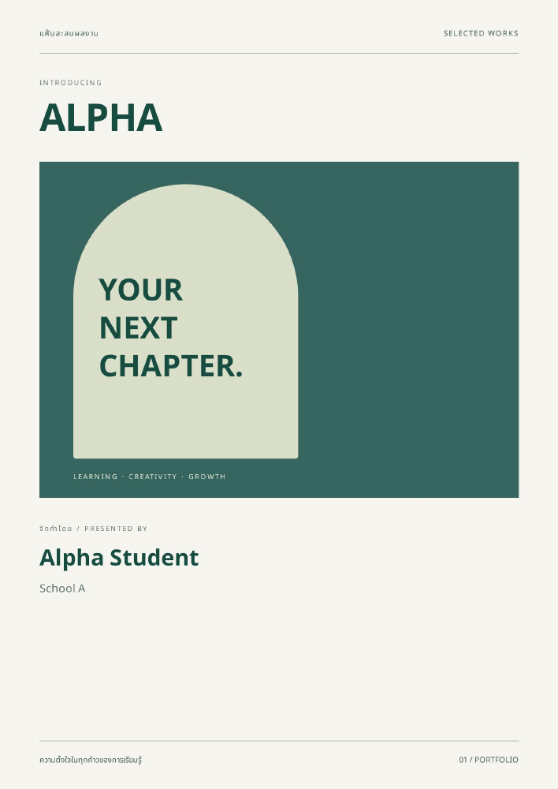

# Emerald Editorial and A4 verification — 2026-10-13

## Open the template

On branch `codex/portfolio-system-fixes`, run the app using your existing Supabase environment. Open an existing portfolio in Editor and choose **Emerald Editorial · เขียว–ครีม** in the template selector. Wait for **บันทึกเทมเพลตแล้ว**. The selection persists after reload. New portfolios can also select this template; it uses the existing `modern` key and requires no new schema migration.

This image comes from the exported PDF using fictional test data. Your name, school, portrait and cover image replace the sample content. The template styles all six sections and additional paginated pages.

## A4 behavior

Pages have a stable 794 × 1123 CSS-pixel layout (A4 at approximately 96 dpi). Preview fits the available width by scaling the whole page uniformly. PDF capture removes preview scaling and uses explicit canvas dimensions. PDF placement uses a single aspect-preserving scale, and retains the selected page background. Export also validates full-size page clones when the mobile preview is hidden.

## Final verification

- Production build and TypeScript: passed.
- ESLint: no errors; 20 image optimization warnings (`no-img-element`).
- Node tests: 2 passed, including selection-transaction ownership and rollback.
- Playwright: 9 passed on Chromium against the production build.
- Tested preview widths: 1440, 1024 and 390 px; every page keeps its A4 ratio and native typography.
- Template selection persists; a failed save preserves the previous design.
- Existing draft preservation, cropping, section loads, stale-response protection, PDF download, overflow detection and ten-page limit remain covered.
- Additional regression: oversized preface is blocked during mobile export with the preview hidden.
- Emerald PDF: 6 A4 pages, 472,941 bytes. Classic empty-content PDF: 6 A4 pages, 425,488 bytes.
- Rendered and visually inspected all six Emerald PDF pages, classic preface and the mobile preview; checked Thai text, proportions and final cream cover background.

## Environment boundary

Browser tests use a local mock Supabase API; transaction tests use local PGlite. Live Supabase credentials were unavailable, so live RLS, storage and deployment were not exercised. The earlier selection-RPC migration remains a separate deployment requirement documented in SYSTEM_FIXES.md. This branch does not change `main`.
